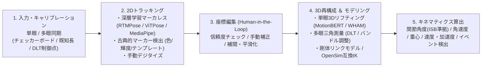
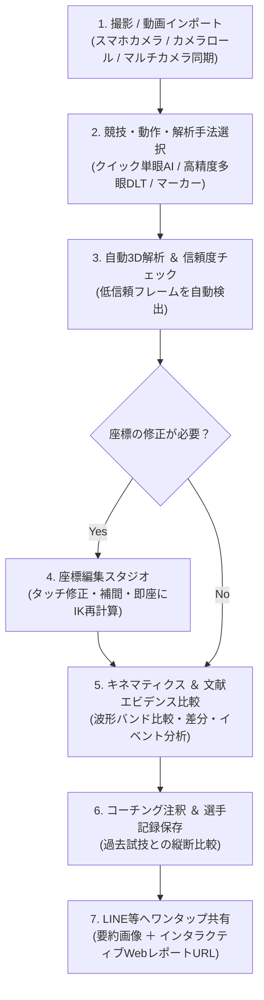
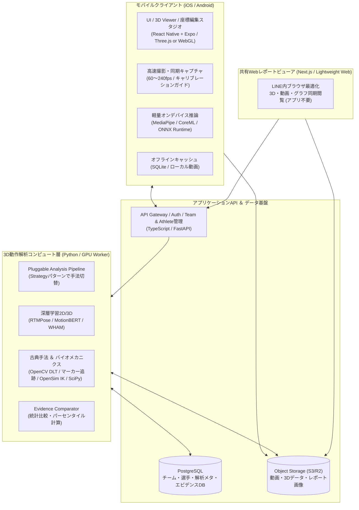

# プロダクトデザイン仕様書

## 1. プロダクトビジョン & コンセプト

### ビジョン
> **すべての指導現場とアスリートに、科学的根拠のある3次元動作解析を手のひらで。**

高価なラボ設備や専門ソフトを必要とした3次元キネマティクス解析を、手元のスマートフォン動画から実行可能にし、「正確な計測（AI＋古典手法＋手動補正）」「科学的解釈（最新文献エビデンス比較）」「現場での伝達（チーム管理＆LINEワンタップ共有）」を一貫してつなぐ次世代スポーツバイオメカニクス・コーチングプラットフォーム。

### コアバリュープロポジション
1. **現場のスピードと研究の厳密さを両立**: 1台のスマホで即座にマーカレス3D解析でき、必要に応じて多眼DLT・マーカー追跡・フレーム単位の座標手動修正までシームレスに深掘りできる。
2. **「数字を出すだけ」で終わらせない**: 最新文献の統計データと自分の動作を並べて比較し、課題と強みをエビデンス付きで理解できる。
3. **選手・チームにすぐ届く**: 分析レポートをLINE等へ1タップで共有でき、選手側がアプリ未導入でも分かりやすく振り返れる。

---

## 2. ターゲットユーザー（ペルソナ）

| ペルソナ | 主な利用シーン | ペイン（現状の課題） | 本アプリで得る価値 |
| :--- | :--- | :--- | :--- |
| **P1: 部活・クラブ・アカデミーのコーチ**（一次ターゲット） | 練習中のフォーム撮影、選手への個別フィードバック、保護者/スタッフへの共有 | 感覚的な指導になりがち。SPLYZAは上位プランが高く、OnFormは3D数値や科学的根拠が足りない。LINEでの指導連携が面倒。 | スマホ撮影→数分で3D角度と文献基準との差を可視化し、LINEで選手に即フィードバック。 |
| **P2: 競技アスリート（高校・大学・社会人）** | 自主練のフォームチェック、過去ベスト時の自分との比較、怪我予防 | 自分の感覚と実際の動きのズレが分からない。トップ選手や理想フォームとの定量的差分を知りたい。 | 縦断的な自分の推移と、文献ベースのエビデンス基準に対する現在地を視覚的に把握。 |
| **P3: スポーツ科学研究者・トレーナー・理学療法士** | フィールド計測、リハビリ復帰評価、精度検証・論文/レポート作成 | ラボ外で計測できない。AIアプリの誤検出を修正できず、どのアルゴリズムで計算されたか不透明。 | DLT法/マーカー追跡/OpenSim互換出力/手動座標編集と信頼度ログにより、フィールド計測の実務・研究に耐えるデータを取得。 |

---

## 3. コア機能設計（5つの柱）

### Pillar 1: マルチ手法3D動作解析エンジン（Pluggable Tracking & Modeling）
解析パイプラインを **4つの交換可能ステージ** に分離し、ユースケースと精度要件に応じて最新手法と古典的手法を選択可能とする。

| カテゴリ | サポート手法 | ユースケース |
| :--- | :--- | :--- |
| **2D検出（最新AI）** | RTMPose, ViTPose, MediaPipe BlazePose（オンデバイス軽量プレビュー用） | 日常練習でのマーカレス高速解析 |
| **2D検出（古典・高精度）** | 反射/カラーマーカー自動追跡（テンプレートマッチング＋オプティカルフロー）、手動デジタイズ | 高速動作・特殊服装・研究計測 |
| **3D再構成（単眼AI）** | MotionBERT（時空間Transformerリフティング）, WHAM（ワールド座標系接地推定） | スマホ1台での即時3D解析 |
| **3D再構成（多眼・古典）** | 2D/3D DLT法（Direct Linear Transformation）、エピポーラ幾何＋三角測量＋バンドル調整 | スマホ2台以上を用いた高精度フィールド計測 |
| **バイオメカニクスモデル** | ISB推奨関節座標系に基づく剛体リンクモデル、OpenSim互換逆運動学（IK）、体節慣性パラメータ（De Leva / 阿江モデル） | 解剖学的に妥当な関節角度・重心算出 |
| **信号処理** | 4次ゼロ位相Butterworthローパスフィルタ（残差分析によるカットオフ自動推奨）、3次スプライン補間 | ノイズ除去と欠損フレーム補完 |

---

### Pillar 2: Human-in-the-Loop 座標編集＆検品スタジオ
AIの誤検出を「見抜いて・直して・再計算できる」モバイル最適化エディタ。

- **信頼度タイムライン＆ヒートマップ**: 各キーポイントの推定信頼度（Confidence Score）と物理的異常（急激な骨長変化・加速度スパイク）をタイムライン上に自動ハイライト。
- **モバイル最適タッチ編集**:
  - 拡大ルーペ（オフセット表示で指で隠れない）によるフレーム単位の2D座標ドラッグ修正。
  - 左右反転（Left/Right Swap）のワンタップ一括入れ替え。
  - オクルージョン区間の「始点・終点修正 → スプライン自動補間」および「再トラッキング（修正点をアンカーとした前後フレーム再推定）」。
- **非破壊リビジョン管理**: AI元データ（Raw）と編集後データ（Edited）を分離保持し、いつでも比較・Undo可能。座標修正後に3D再構成とキネマティクス指標を数秒で再計算。

---

### Pillar 3: コーチング支援・キネマティクス分析UI
- **同期マルチビュー**: 「元動画＋2D骨格オーバーレイ」「任意角度に回転できる3Dスケルトンビューア」「キネマティクス時系列グラフ（角度・角速度・重心軌跡）」をフレーム完全同期で再生。
- **動作イベント自動・手動タギング**: 例）投球（フットコンタクト / 最大外旋MER / ボールリリース）、ランニング（接地 / 離地）、ジャンプ（最下点 / 離地 / 着地）。イベント間タイミング（キネティックチェーン順序）を可視化。
- **比較モード**:
  - 同一選手の「過去 vs 現在」重ね合わせ（3D同期オーバーレイ / グラフ重ね描き）。
  - 2画面同期再生（イベント基準での時間軸正規化 0%〜100%）。
- **コーチング注釈**: スロー再生（0.1x〜1.0x）、動画上ドローイング（角度・補助線・軌跡残像 StroMotion風）、音声・テキストによるコーチコメント付与。

---

### Pillar 4: 最新文献エビデンス＆統計ベンチマーク比較
単なる数値表示を超え、スポーツ科学の査読文献に基づく客観的基準と自身の動作を比較する機能。

- **構造化エビデンスDB（Evidence Registry）**:
  - 競技 × 動作 × 対象属性（競技レベル・性別・年代）ごとに、査読論文から抽出したキネマティクス指標の統計値（平均 $\mu$、標準偏差 $\sigma$、IQR、推奨レンジ、傷害リスク閾値）を格納。
  - **透明性の担保**: すべての基準値に **出典メタデータ（著者・年・ジャーナル・DOI・サンプルサイズ $N$・計測機器/手法）** を紐付け、計測手法の違い（光学式MoCap vs スマホ3D）によるバイアス注記も明示する。
- **比較ビジュアライゼーション**:
  - **指標カード（zスコア / パーセンタイルゲージ）**: 自分の値が文献の規範分布のどこに位置するかを直感的に表示。
  - **波形バンド比較**: 時間正規化（0%〜100%）した文献の平均波形 ± 1SD バンド上に、自身の時系列曲線を重ねて表示。
- **コーチングアクション提案**: 規範レンジから大きく外れた指標（例：着地時の膝外反角度過大、投球時の体幹回旋タイミング遅延）に対し、エビデンスに紐づくチェックポイント・推奨ドリル候補を提示（※医療診断ではなく指導支援情報として免責明示）。

---

### Pillar 5: チーム・選手パフォーマンス管理 ＆ LINE等レポート共有
- **階層管理モデル**: `Organization / Team` → `Athlete` → `Session（撮影日・環境・使用手法）` → `Trial（試技動画・解析結果・コメント）`。
- **縦断的パフォーマンスダッシュボード**: 選手ごとの主要キネマティクス指標の推移グラフ、トレーニング介入前後の変化量、チーム内一覧・フィルタ。
- **LINE等ワンタップ共有体験**:
  1. **サマリー画像カード生成**: 主要3Dスナップショット＋主要指標（文献比較バッジ付き）＋コーチの一言を1枚の縦長インフォグラフィック画像に自動レイアウトし、LINEトークへ即送信。
  2. **閲覧専用WebレポートURL（OGPリッチプレビュー付き）**: LINEでタップするとアプリ未インストールでもモバイルブラウザで「同期動画＋回転可能3Dモデル＋文献比較グラフ＋コーチ音声/テキストコメント」を閲覧可能（閲覧期限・パスワード/チーム限定公開制御あり）。
  3. **研究・外部連携エクスポート**: CSV（2D/3D座標、関節角度）、C3D / TRC / MOT（OpenSim互換）形式でのダウンロード。

---

## 4. コアユーザージャーニー

---

## 5. システムアーキテクチャ構想

小規模開発での開発速度・保守性・マルチプラットフォーム対応・計算負荷のバランスから、以下の **ハイブリッド・モジュラー構成** を第一候補とする（Phase 1 の技術検証プロトタイプで最終確定する）。

iOS / Android の第一候補は React Native（Expo）とし、LINE 共有 Web ビューアと TypeScript データ契約を共有する。Phase 1 の Spike #6 で実機検証し、ADR #26 で採否を確定する。

### 設計上の重要原則（アーキテクチャ境界）
1. **解析エンジンの完全なプラガビリティ**: `Tracker2D`、`Reconstructor3D`、`KinematicModel`、`Filter` を厳格なインターフェース（入出力スキーマ：JSON Schema / Pydantic / TypeScript型共有）で分離し、古典手法と最新深層学習手法を同一データモデル上で差し替え可能にする。
2. **決定論的再計算の分離**: 座標編集後の「フィルタリング → 3D再構成（DLT等）→ 関節角度算出」は軽量な決定論的計算として分離し、GPU推論をやり直さずに高速フィードバック（目標 1〜3秒以内）を実現する。
3. **プライバシー＆セキュリティ**: アスリート（未成年含む）の映像データを扱うため、共有URLは推測不可能な署名付きトークン＋有効期限＋権限設定を必須とし、同意管理を初期設計から組み込む。

---

## 6. 段階的スコープ計画（MVP → 拡張）

初期から全競技・全手法を同時に作ると小規模開発では破綻するため、**垂直スライスで価値を検証しながら拡張**する。

| リリース段階 | 対象範囲 | 含まれる主要機能 |
| :--- | :--- | :--- |
| **V0.1 (Spike / PoC)** | 単一動作（例：垂直跳び・スクワット・投球のいずれか1動作） | スマホ動画インポート → 単眼AI 3D解析 + DLT検証 → 関節角度算出 → 精度ベンチマーク比較 |
| **V1.0 (MVPリリース)** | 野球投球（速球）、ランニング（地上・トレッドミル）、垂直跳び（CMJ）とドロップ垂直跳び（DVJ）の跳躍・着地（[計測・検証仕様](./05-mvp-sports-and-validation.md)） | ・単眼マーカレス3D（RTMPose + MotionBERT/WHAM）＋古典2D/3D DLT（2カメラ対応） ・モバイル座標編集（手動修正・補間・再計算） ・主要キネマティクス分析＆2試技比較 ・エビデンスDB（初期15〜30編の査読論文に基づく規範比較） ・チーム/選手管理 ＋ LINEワンタップ共有（画像＋WebレポートURL） |
| **V1.5 (現場強化)** | 対象競技拡大（ゴルフ・テニス・バレー・陸上等） | ・マーカー自動追跡モード強化、道具先端トラッキング（バット/ラケット等） ・マルチカメラ自動時刻同期（音声/フラッシュ同期） ・音声解説付きコーチングフィードバック |
| **V2.0 (研究・プロ拡張)** | 研究者・プロチーム向け | ・OpenSim完全連携（筋骨格シミュレーション・キネティクス推定） ・C3D / TRC / MOTエクスポート ・カスタムエビデンス登録（チーム独自基準値・研究データ取り込み） |
