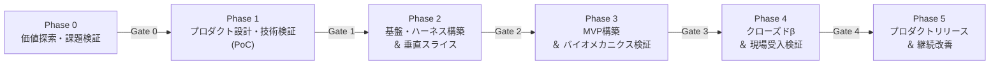

# 開発プロセス ＆ 品質要件定義（小規模開発・価値探索〜リリース）

## 1. プロセス設計の基本思想

本プロジェクトは **小規模チーム（1〜3名の人間 ＋ AIエージェント群）** での開発を前提とする。
小規模開発における最大の失敗パターンは「① 価値検証前に重厚な実装へ突入すること」「② 3Dバイオメカニクス精度というドメイン固有の品質を曖昧にしたまま機能を増やすこと」「③ AIエージェントに無秩序なコードを生成させ技術的負債で自壊すること」の3点である。

これらを防ぐため、**価値探索（Phase 0）からプロダクトリリース（Phase 5）までの6工程**を定義し、すべての工程に **客観的・検証可能な品質要件（Quality Gate / Exit Criteria）** を設定する。次工程への進行は、原則として現工程の品質ゲートをすべて満たすことを条件とする。

---

## 2. 全体ライフサイクル（Phase 0 〜 Phase 5）

---

## 3. 各工程の定義と品質要件（Quality Gates）

### Phase 0: 価値探索・課題検証（Discovery & Problem Validation）
- **目的**: 「誰の・どの競技の・どの現場課題」を最優先で解くかを検証し、初期MVPの対象競技とコア価値を確定する。
- **主要アクティビティ**:
  - 競合調査・市場ギャップ分析（[01-competitive-analysis.md](./01-competitive-analysis.md)）
  - ターゲットユーザー（部活/クラブコーチ、アスリート、トレーナー/研究者）への課題インタビュー（最低5〜10名）
  - 既存ツール（SPLYZA / OnForm / Kinovea等）の現場ワークフロー観察、LINE共有・文献比較ニーズの検証
  - MVP対象競技（2〜3競技）と代表動作（例：野球投球、ランニング、垂直跳び/着地）の選定
- **成果物**:
  - 競合調査レポート、ユーザーインタビュー要約、課題仮説リスト、MVPスコープ定義書（V1.0）
- **人間とエージェントの役割**:
  - 人間：インタビュー実施、現場観察、意思決定（Go / Pivot）
  - エージェント：競合・文献調査、インタビュー設計支援、発見事項の構造化
- **Quality Gate 0（次工程へのExit Criteria）**:
  - [ ] 競合比較と差別化仮説が文書化され、既存ツールでは解決できない明確なペインが3点以上特定されている。
  - [ ] ターゲット層へのヒアリングから、初期対象競技・動作と「LINEレポート共有・座標編集・エビデンス比較」の優先順位が確定している。
  - [ ] ターゲットとなる査読文献データ（最低15編以上）の入手可能性と取得指標の定義が確認できている。

---

### Phase 1: プロダクト設計・技術検証プロトタイプ（Design & Technical Spike）
- **目的**: 技術的リスクが最も高い要素（スマホ動画からの3D再構成精度、古典DLTとの互換性、モバイルでの座標編集UX、LINE内ブラウザでの3Dレポート表示）を使い捨てプロトタイプ（Spike）で早期検証し、技術スタックとドメインモデルを確定する。
- **主要アクティビティ**:
  - プロダクトデザイン仕様・画面遷移・ワイヤーフレーム作成（[02-product-design.md](./02-product-design.md)）
  - **Spike 1（3D解析エンジン比較ベイクオフ）**: 同一テスト動画に対し、単眼AI（RTMPose+MotionBERT / WHAM）および2カメラDLT法の精度・推論時間・計算コストを定量計測
  - **Spike 2（座標編集UX検証）**: スマホ実機で拡大ルーペ付き2Dキーポイント修正〜再計算がストレスなく操作できるか検証
  - **Spike 3（LINE共有プレビュー検証）**: OGP表示、LINEアプリ内ブラウザでの軽量3D表示・動画同期再生の動作確認
  - 技術スタック選定（ADR: Architecture Decision Records 作成）およびドメインデータスキーマ（JSON Schema / 型定義）設計
- **成果物**:
  - プロダクト設計書、UIプロトタイプ、技術検証ベンチマーク結果（実測数値付き）、ADR群、共有データ契約（Contract Schema）
- **Quality Gate 1（Exit Criteria）**:
  - [ ] すべての主要技術選定（モバイルFW、3Dビューア、解析パイプライン、バックエンド/ストレージ）および **ブランチ・テスト・バージョン戦略** がADRとして根拠・トレードオフ付きで確定している。
  - [ ] 高リスク領域（非同期解析/座標編集の状態遷移、座標変換/幾何・物理不変条件、マルチテナント/LINE共有認可境界）に対する **形式検証・機械的検証対象モデル仕様** が設計されている。
  - [ ] ベンチマーク動画（既知の基準値または公開MoCapデータセット：Human3.6M / Sportsデータ等）に対し、以下を実測確認している：
    - 多眼DLTモード：既知距離・角度の誤差基準を満たす（例：キャリブレーション再投影誤差 < 2.0 px、主要関節角度RMSE < 5°）
    - 単眼AIモード：主要矢状面関節角度の傾向一致（相関係数 $r \ge 0.85$、主要角度RMSE < 10°を目安に実測ベースラインを記録）
  - [ ] LINEアプリ内ブラウザ（iOS / Android）で共有レポートプロトタイプがクラッシュせず3秒以内に初期表示される。
  - [ ] Spikeの使い捨てコードは本体リポジトリへ混入させず、知見のみADRとテストデータへ昇華されている。

---

### Phase 2: 基盤・ハーネス構築 ＆ 垂直スライス（Foundation, Harness & Walking Skeleton）
- **目的**: Lauren Tan手法に基づく **エージェント駆動開発ハーネス**（型制約・Linter・CI品質ゲート・バイオメカニクス自動評価ハーネス）を実装し、最小のEnd-to-End垂直スライス（動画1本アップロード → 解析 → 3D表示 → 共有URL生成）を実機で通す。
- **主要アクティビティ**:
  - モノレポ/リポジトリ構造、厳格な型チェック・Lint・フォーマット・アーキテクチャ境界検査の自動化
  - **Biomechanics Eval Harness（自動数値検証スイート）** の構築（ゴールデンデータセットに対する角度・物理不変条件の回帰テスト）
  - E2E実行時検証環境（Web/API自動テスト、モバイルシミュレータ/実機検証スクリプト）の整備
  - 認証・チーム/選手データモデル・非同期解析ジョブキューの最小実装
  - Walking Skeleton（1試技の撮影/選択 → 1手法での3D解析 → 画面表示 → 共有リンク発行）の開通
- **成果物**:
  - 稼働するCI/CDパイプライン、Eval Harness、実機動作するWalking Skeleton、更新された `AGENTS.md` / Playbooks / Skills
- **Quality Gate 2（Exit Criteria）**:
  - [ ] CIにて `typecheck` / `lint` / `unit test` / `property-based test` / `contract test` / `biomech-eval` が完全自動実行され、`main` ブランチ保護で違反PRが機械的にブロックされる。
  - [ ] 状態遷移モデル・座標/幾何/物理不変条件・マルチテナント認可境界の機械的検証（形式モデル検査またはプロパティベース/網羅テスト）がCIへ組み込まれている。
  - [ ] 4軸のバージョン戦略（App / Contract / Pipeline・Model / EvidenceDB）がスキーマ・出力メタデータに組み込まれている。
  - [ ] Walking SkeletonがiOS・Android双方でEnd-to-End動作し、再現可能な実行ログ/動画証跡が記録されている。
  - [ ] エージェントが `Sub-issue → Worktree → 実装 → 検証 → PR` のループを自力で完結できる状態（Trust Level 2到達）。

---

### Phase 3: コア機能開発・MVP構築（MVP Build & Biomechanical Validation）
- **目的**: MVP（V1.0）の全5本柱（マルチ手法解析、座標編集スタジオ、コーチング分析UI、文献エビデンス比較、チーム管理＆LINE共有）を小さな検証可能単位（Verifiable Units）に分解して実装・統合する。
- **主要アクティビティ**:
  - 解析パイプラインのプラガブル実装（単眼マーカレス3D、古典2D/3D DLT、手動デジタイズ、Butterworthフィルタ＆スプライン補間）
  - 座標編集スタジオ実装（信頼度ヒートマップ、拡大ルーペ手動修正、左右反転修正、非破壊リビジョン、高速再計算）
  - コーチング分析画面（同期マルチビュー、2試技重ね合わせ比較、イベントタギング、ドローイング/コメント）
  - エビデンスDB投入（初期15〜30編の査読論文メタデータ＋正規化統計値）＆比較UI実装
  - チーム/選手管理、縦断ダッシュボード、LINEワンタップ共有（要約インフォグラフィック画像生成＋WebレポートURL）
- **Quality Gate 3（Exit Criteria）**:
  - [ ] **機能完了**: MVP要件の全ユーザーストーリーが実機およびWebビューアでEnd-to-End検証済み。
  - [ ] **バイオメカニクス品質**:
    - ゴールデンデータセットに対する角度・速度回帰テストが100%パス（許容誤差逸脱なし）。
    - 座標手動修正後の再計算が、修正点反映＆骨長/フィルタ制約違反ゼロで完了（再計算レイテンシ目標：5秒以内）。
    - 登録済み全エビデンスデータに出典（DOI/著者/年/対象属性/計測手法）が欠損なく紐付き、計算式（zスコア・パーセンタイル）が単体テストで検証済み。
  - [ ] **信頼性・性能**:
    - 10秒（60fps）動画の単眼3D解析完了時間：目標60秒以内（P95）。
    - 解析ワーカー失敗時のリトライ・明確なエラー表示・オフライン撮影データのローカル保全が検証済み。
  - [ ] **セキュリティ・プライバシー**:
    - 共有URLの権限境界テスト（他チームデータへの不正アクセス不可、期限切れトークン拒否）が100%パス。
    - 認証・動画署名付きURL・個人情報削除フローのセキュリティチェック完了。

---

### Phase 4: クローズドβ検証・現場受入試験（Field Beta & Hardening）
- **目的**: 実際のグラウンド・体育館・練習場にて、協力チーム/コーチ/選手（3〜5チーム、20〜50名規模）に継続利用してもらい、実環境（逆光・服装・不安定回線・実機機種差・LINE共有の実反応）での課題を潰し切る。
- **主要アクティビティ**:
  - TestFlight（iOS）/ 内部テストトラック（Android）での配信
  - 屋外・屋内・複数端末での撮影〜解析〜座標編集〜LINE共有の現場テスト
  - エラー監視（Crashlytics / Sentry）、解析失敗率・座標編集利用率・LINE開封率などの計測
  - 現場で発見されたエッジケースをすべて回帰テスト/Evalデータセットへ追加（Failure-to-Constraint Loop）
  - パフォーマンス最適化・バッテリー/ストレージ消費改善・ストア審査準備（プライバシーポリシー、免責事項、医療機器非該当の表現確認）
- **Quality Gate 4（Exit Criteria）**:
  - [ ] **安定性**: β期間（最低2〜4週間）において、クラッシュフリーセッション率 ≥ 99.5%、解析ジョブ完了成功率 ≥ 97%。
  - [ ] **実用性（UX指標）**: 現場コーチが説明なしで「撮影 → 解析 → LINEレポート共有」までを初回完了でき、主要操作の中断・致命的UX障害がゼロ。
  - [ ] **実環境耐性**: 低速回線/オフライン状態での撮影→再接続後アップロードがデータ消失なく完了する。
  - [ ] **法務・コンプライアンス**: 医療診断ではない旨の免責表示、未成年含む選手映像のプライバシー同意フロー、OSSライセンス表記（各MLモデル・ライブラリの商用利用ライセンス精査完了）がすべてクリアされている。
  - [ ] **リリース手順検証**: 本番環境へのデプロイ、DBマイグレーション、ロールバック手順がステージング環境で予行演習済み。

---

### Phase 5: プロダクトリリース ＆ 継続改善（Release & Telemetry-Driven Iteration）
- **目的**: ストア公開（V1.0）を行い、実運用テレメトリとユーザーフィードバックに基づいて安全かつ高速に機能拡張（V1.5 / V2.0）を回す。
- **主要アクティビティ**:
  - App Store / Google Play リリース、Webレポート本番公開
  - 可観測性ダッシュボード運用（解析レイテンシ、GPUコスト/試技、座標修正頻度、LINE共有開封率、継続率）
  - エビデンスDBの定期アップデート（最新論文の追加・バージョン管理）
  - 新規トラッキング/モデリング手法の追加（プラグイン追加時は必ず `/arena` ベイクオフと `biomech-eval` 通過を必須化）
- **Quality Gate 5（運用定常品質基準）**:
  - [ ] すべての本番リリースが自動品質ゲート（CI + Eval + Canary確認）を通過している。
  - [ ] リバート率（デプロイ後ロールバック率） < 2%、重大障害（P0/P1）のMTTR < 4時間。
  - [ ] ユーザー起因のトラッキング失敗ケースが匿名化（同意取得済み）のうえ定期的にEvalセットへ還流され、モデル精度とハーネスが継続強化されている。

---

## 4. 横断的品質要件サマリー（Non-Functional Requirements）

| 品質特性 | 指標・要件 | 検証手段 |
| :--- | :--- | :--- |
| **バイオメカニクス妥当性** | ISB準拠座標系定義、既知幾何・公開MoCapベンチマークに対する回帰基準維持、使用手法・信頼度・出典の完全透明性 | 自動 `biomech-eval` スイート（CI必須） |
| **データ整合性・再現性** | 同一入力動画＋同一パイプラインバージョン＋同一編集履歴からビット/数値誤差許容内で同一結果を再現可能 | 決定論的テスト・パイプラインバージョン固定 |
| **パフォーマンス** | 座標編集後の再計算 ≤ 5秒、LINE共有Webレポート初期表示 ≤ 3秒、動画再生フレーム同期ズレ ≤ 1フレーム | 自動ベンチマーク（`/benchmark-checklist`） |
| **セキュリティ・プライバシー** | 動画・個人情報の暗号化保存（転送時TLS / 保存時暗号化）、共有URLの署名＆期限管理、テナント（チーム）分離 | 権限境界テスト・静的脆弱性スキャン |
| **ライセンス適合性** | 組み込む深層学習モデル（RTMPose / MotionBERT / WHAM等）およびライブラリ（OpenSim等）の商用ライセンス条件を個別に事前確認・準拠 | Phase 1 ADRでのライセンス監査・CI依存チェック |
| **保守性（AI協調適性）** | モジュール境界の厳格化、循環依存禁止、不要コメント・デッドコード排除、小粒なPR単位 | 静的解析・アーキテクチャテスト・`/unslop` |

---

## 4.5 横断的エンジニアリング戦略（検討・強制フェーズ対応表）

ブランチ・テスト・バージョン・形式/機械的検証の4戦略は、**「設計・ADR確定」と「機械強制（CI/実装）」の段階を分離**して管理する。

| 戦略領域 | 設計・ADR確定 | 機械強制・基盤実装 | 拡張・運用 | 中核方針 |
| :--- | :--- | :--- | :--- | :--- |
| **ブランチ戦略** | Phase 0末〜Phase 1開始前 | Phase 2（保護設定・CI必須） | Phase 3〜5 | **Trunk-Based Development**（`main` 常時グリーン・短命ブランチ・Squash Merge）＋ **Issue/Sub-issue 1:1 連動 Worktree**。Spikeブランチは `main` 非マージ。 |
| **テスト戦略** | Phase 1 後半 | Phase 2（CI・Eval稼働） | Phase 3〜5 | **5層構造**: ①型/スキーマ/境界Lint ②単体＆プロパティベーステスト ③契約テスト ④`biomech-eval` 精度回帰 ⑤実機/Playwright E2E・認可境界テスト。 |
| **バージョン戦略** | Phase 1 後半 | Phase 2（契約・メタ組込） | Phase 4（ストア運用確定） | **4軸独立管理**: ①App/Web（SemVer+Build） ②API/Contract互換版 ③Analysis Pipeline & Model（版＋重みハッシュ＋フィルタ仕様） ④Evidence Registry版（過去レポート不変性担保）。 |
| **形式・機械的検証モデリング** | Phase 1 後半（高リスク核抽出） | Phase 2（CI組込） | Phase 3（実装同期検証） | 高リスク核に集中適用：①非同期解析/オフライン同期/座標編集の状態遷移（TLA+/Quint/FSM+MBT） ②座標変換・回転行列・DLT・ゼロ位相フィルタの代数的不変条件（Hypothesis/Z3） ③マルチテナント＆LINE共有トークン認可境界モデル。 |

---

## 5. GitHub Projects / Milestones / Issues / Sub-issues ＆ Worktree 連動運用

本プロジェクトの進捗・マイルストーン・開発項目の唯一の管理台帳（Single Source of Truth）は **GitHub Issues / Milestones / GitHub Projects（Projects v2）** とする。

### 5.1 マイルストーン構成（工程と1対1対応）
| Milestone | 対応フェーズ | 主な完了基準 |
| :--- | :--- | :--- |
| `Phase 0: Discovery & Validation` | Phase 0 | 競合分析・課題検証・対象競技確定・Gate 0 通過 |
| `Phase 1: Design & Technical Spikes` | Phase 1 | 技術検証Spike 1〜3・ADR・契約スキーマ確定・Gate 1 通過 |
| `Phase 2: Foundation, Harness & Walking Skeleton` | Phase 2 | CI/Evalハーネス稼働・Walking Skeleton開通・Gate 2 通過 |
| `Phase 3: MVP Build (V1.0)` | Phase 3 | MVP 5本柱実装完了・精度/セキュリティ検証・Gate 3 通過 |
| `Phase 4: Field Beta & Hardening` | Phase 4 | 実地βテスト・クラッシュ/成功率基準達成・Gate 4 通過 |
| `Phase 5: V1.0 Release & Operations` | Phase 5 | ストア公開・監視＆継続Eval還流運用開始・Gate 5 達成 |

### 5.2 Issue / Sub-issues 階層構造・ラベル・Worktree 連動運用
- **GitHub Sub-issues による構造化**:
  - **Parent Issue**: フェーズ内の工程・Spike・MVP Epic（例：`#5`, `#8`, `#10`, `#13`〜`#17`）。
  - **Sub-issue（Verifiable Unit）**: 独立して設計・実装・テスト・PRマージできる最小単位。GitHub ネイティブの **Sub-issues** で親 Issue へ紐付け、GitHub Project の `Parent issue` / `Sub-issues progress` で進捗を自動集計する。
  - 各フェーズ末尾には必ず `[Gate N]` Issue を配置し、Quality Gate チェックリストを管理する。
- **タスク（Issue/Sub-issue）と Git Worktree の 1:1 連動**:
  - コード・設計変更を伴うすべての実行タスク（Sub-issue または単体 Issue）は、`scripts/worktree.ps1` を用いてリポジトリ外の隔離ワークツリー（`../sports-motion-app.worktrees/issue-<num>-<slug>`）と専用短命ブランチ（`<type>/<num>-<slug>`）を 1:1 で作成して作業する。
  - 実装ワーカー（Codex CLI `gpt-6.2-sol`）は対象タスクの worktree パスを指定して実行し、PR マージ完了後に worktree とローカルブランチを片付ける。
- **ラベル体系**:
  - 種別: `type:discovery`, `type:spike`, `type:feature`, `type:harness`, `type:eval`, `type:adr`, `type:quality-gate`, `bug`
  - 領域: `area:motion-engine`, `area:mobile-ui`, `area:coord-editor`, `area:evidence-db`, `area:team-share`, `area:infra-ci`
  - 優先度: `priority:p0`, `priority:p1`, `priority:p2`
- **GitHub Project（`Sports Motion App Roadmap`）**:
  - ステータス列: `Todo` → `In Progress` → `Done`
  - カスタム属性: `Phase`, `Priority`, `Area`（＋標準 `Parent issue`, `Sub-issues progress`）
  - すべての開発作業は Issue / Sub-issue を起点に開始し、PR（`.github/pull_request_template.md` 準拠の証跡付き）と `Closes #<id>` で紐付けてクローズする。

