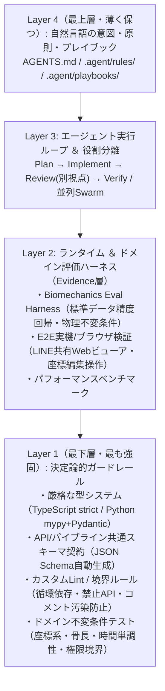
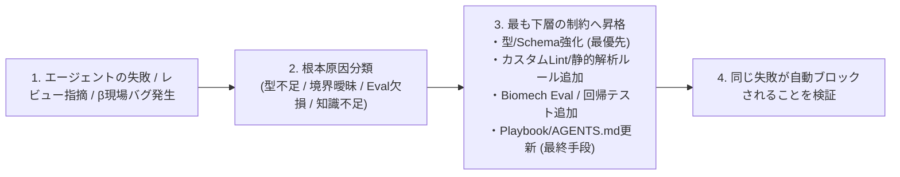

# エージェント駆動開発ハーネス設計書（Lauren Tan 手法準拠）

## 1. 設計の思想的基盤：Lauren Tan（`@poteto` / `pstack`）の開発手法

本プロジェクトのエージェント駆動開発（Agent-Driven Development）は、**Lauren Tan**（`@poteto`、元React Core Team / Cursor / SpaceX AI）が体系化した開発手法およびオープンソースフレームワーク **`pstack`** の思想を基礎とする。

Lauren Tan の手法の本質は「プロンプトを工夫してAIに大量のコードを書かせること」ではなく、**「信頼できる検証インフラ（Harness）と決定論的な制約をコードベースに埋め込み、エージェントが自力で正しさを証明できる環境を構築すること」** にある。

### 継承する5つの中核原則

| # | Lauren Tan の原則 | 本プロジェクトでの具体的解釈と適用 |
| :--- | :--- | :--- |
| **1** | **Trust First, Parallelism Second**<br>（信頼が先、並列化は後） | 検証基盤が未整備のまま複数エージェントを並列稼働させると、負債（AI Slop）が倍速で増殖する。まずは単一エージェント＋厳格なローカル検証で信頼を確立し、信頼曲線（Trust Curve）に沿って段階的に並列化を解放する。 |
| **2** | **Inverted Pyramid of Trust**<br>（逆ピラミッド型の信頼構造） | 自然言語の指示（プロンプト）は最も脆い制約である。正しさの保証を「プロンプト」ではなく、**型システム・静的解析・スキーマ契約・ドメイン不変条件・決定論的テスト・ランタイム検証** という下層の強固な決定論的制約へ押し下げる。 |
| **3** | **Codebase as Memory**<br>（コードベースを記憶とする） | エージェントは既存コードのパターンを忠実に模倣する（悪いパターンも含めて）。最初からクリーンなモジュール境界・一貫した命名・禁止パターンのLint化を行い、コードベース自体を最良の仕様書にする。 |
| **4** | **Verification as a First-Class Citizen**<br>（実行時検証の第一級化） | 「コンパイルが通った」「ユニットテストが緑」だけでは完了とみなさない（*Evidence before confidence*）。実アプリ・Webビューア・**バイオメカニクス数値評価ハーネス** で実際に動作と数値を証明し、証跡を残すことを完了条件とする。 |
| **5** | **Intent Specification is the Bottleneck**<br>（意図仕様がボトルネック） | エージェントの実行速度が上がるほど、人間の付加価値は「コードを書くこと」から **「意図・アーキテクチャ境界・品質ゲート・評価基準（Eval）を明確に定義すること」** へ移行する。 |

---

## 2. 逆ピラミッド型ハーネス構造（Inverted Pyramid of Trust）

本プロジェクトでは、以下の4層でハーネスを構築し、下層ほど強固かつ自動強制される構造とする。



### 本ドメイン固有の決定論的制約（Layer 1〜2に必ず押し下げるもの）
スポーツ3次元動作解析アプリは「見た目上動いているが、数値がデタラメ（座標軸の取り違え、左手系/右手系の混在、フィルタ位相ズレ、単位のrad/deg混同）」という **サイレントバグ** が致命傷になる。以下をプロンプト任せにせず、型と自動テストで機械的に封じる：

1. **物理単位・座標系の型レベル分離（Newtype / Branded Types）**:
   - `Degrees` vs `Radians`、`Meters` vs `Pixels`、`WorldCoord3D` vs `CameraCoord3D` vs `ImageCoord2D`、`FrameIndex` vs `TimestampSec` を素の `number` / `float` で扱わない。
2. **解析パイプライン入出力契約の単一ソース化**:
   - モバイル（TypeScript/Dart）、バックエンド、Python解析ワーカー間で共有するスキーマ（`Pose2DSequence`, `Pose3DSequence`, `CalibrationParams`, `KinematicMetrics`, `EvidenceComparison`）を単一のSchema定義から自動生成し、不整合をCIで即死させる。
3. **物理的・解剖学的不変条件テスト（Property-Based & Invariant Tests）**:
   - 剛体リンクモデル出力においてフレーム間の骨長変動が許容範囲内であること。
   - ゼロ位相Butterworthフィルタ適用前後でピーク時刻の位相ズレが発生しないこと。
   - 座標編集のUndo/Redo・再計算が決定論的かつ冪等であること。
4. **Biomechanics Eval Harness（精度回帰ベンチマーク）**:
   - 合成データ（既知の3D軌跡を仮想カメラで2D投影したもの：真値誤差0のテストケース）と公開基準データセットを用いた自動評価スクリプトを用意し、解析ロジック変更時は必ず RMSE・相関係数・処理時間を自動レポートさせる。
5. **高リスク核に対する形式検証・機械的検証モデリング（Phase 1設計 → Phase 2 CI組込）**:
   - **状態遷移モデル（TLA+ / Quint または 有限状態機械＋Model-Based Testing）**: オフライン撮影・アップロード・非同期解析・座標編集（Undo/Redo）・再計算・共有失効のライフサイクルにおいて、データ消失・レースコンディション・デッドロックがないことを検証。
   - **代数的・幾何的不変条件（Hypothesis / fast-check / 必要箇所でZ3）**: 座標系変換の可逆性（`World ↔ Camera ↔ Image`）、回転行列直交性（$R^T R = I, \det(R)=+1$）、DLT合成誤差上界、ゼロ位相フィルタ対称性を機械検証。
   - **マルチテナント・LINE共有トークン認可モデル**: 他チーム映像・失効トークン・権限昇格に対する到達不能性を宣言的ポリシー／網羅テストで証明。

---

## 3. 信頼曲線（Trust Curve）に基づく自律度フェーズ管理 ＆ 役割分担

### 役割分担モデル（Orchestrator × Implementation Worker）
本プロジェクトでは、責務分離によってレビューの独立性と実装スループットを両立する：
- **Orchestrator / Architect / Quality Gatekeeper**: 意図仕様（Intent Specification）・ADR策定・GitHub Projects/Issues管理・タスクのVerifiable Units分割・批判的レビュー・最終ゲート判定を担当。
- **Implementation Worker（手を動かす実装役：`codex exec -m gpt-6.2-sol`）**: ローカル Codex CLI の `gpt-6.2-sol` を主力の実装・プロトタイプ構築・テスト実装・リファクタリング実行役として起用する。
  - **Issue / Sub-issue ⇄ Git Worktree 1:1 連動**: 大きなタスクは GitHub ネイティブの **Sub-issues** で Verifiable Units に分解し、`scripts/worktree.ps1 start -Issue <num> -Type <type> -Slug <slug>` で隔離ワークツリー（`../sports-motion-app.worktrees/issue-<num>-<slug>`）と短命ブランチを作成した上で、対象ワークツリーに対して `codex exec -m gpt-6.2-sol -s workspace-write -C <worktree-path> -` を実行する。
  - 実装完了後は必ず独立視点での差分レビュー（`codex exec review` または別エージェントレビュー）と自動検証を実行し、PRマージ後に `scripts/worktree.ps1 finish -Issue <num> -DeleteBranch` でクリーンアップする。

Lauren Tan の **「Trust First, Parallelism Second」** に従い、開発フェーズに連動させてエージェントの自律度・並列度を段階的に引き上げる。

| Trust Level | 適用フェーズ | 許可されるエージェント運用 | 解放条件（次レベルへのゲート） |
| :--- | :--- | :--- | :--- |
| **Level 0: Supervised** | Phase 0〜1 | 単一エージェントによる調査・設計・使い捨てSpike作成。すべての設計決定（ADR）を人間がレビュー。 | ADR確定、データ契約確定、Spikeベンチマーク完了。 |
| **Level 1: Verified Single** | Phase 2 | 単一エージェントが `Plan → Implement → Verify` をローカルで完結。人間は設計境界と検証証跡をレビュー。 | CI全ゲート稼働、`biomech-eval` 稼働、Walking Skeleton開通。 |
| **Level 2: Bounded Parallel** | Phase 3 | 境界が分離された領域（例：モバイルUI、共有Webビューア、Python解析パイプライン、エビデンスDB）に対し、**独立ワークスペース（worktree/share）での並列エージェント（Swarm）** を解禁。別エージェントによるクロスレビュー必須。 | 30 PR連続で重大回帰・リバートゼロ、E2E検証の自動再現確立。 |
| **Level 3: Autonomous Loops** | Phase 4〜5 | 定型バグ修正、テスト拡充、モデル精度最適化（Hillclimb）、エビデンス取り込みをバックグラウンド/定期ループで自律実行。最終マージは厳格なCI＋Eval＋人間承認（または低リスク領域のみ自動マージ）。 | βテスト通過、監視・ロールバック自動化完了。 |

---

## 4. `pstack` 準拠のルール・プレイブック・スキル体系

本リポジトリでは `.agent/` 配下に Lauren Tan の `pstack` 構造を取り入れた標準ワークフローを整備する。

### 4.1 Principles（判断基準となる単一ルール：`.agent/rules/principles.md`）
エージェントはすべてのタスクで以下の原則を遵守し、判断時に明示的に参照する：
1. **Prove It Works（動作を証明せよ）**: 推測や静的チェック通過で「完了」と言わない。実実行コマンド出力・テスト結果・Eval数値・画面/ログ証跡を提示する。
2. **Fix Root Causes（根本原因を直せ）**: 対症療法のパッチやワークアラウンドを禁止し、原因箇所を特定して修正する。
3. **Subtract Before You Add（足す前に引け）**: 新規抽象化やコードを追加する前に、不要コードの削除・既存構造の単純化を検討する。
4. **Laziness Protocol（最小変更プロトコル）**: 目的を安全に達成する最小限の差分にとどめ、スコープ外の過剰設計・リファクタリングを混ぜない。
5. **Model the Domain（ドメインを先にモデル化せよ）**: 実装前に境界とデータ型（物理単位・座標系・不変条件）を明確にする。
6. **Explain the Number（数値を説明せよ）**: 精度・速度・誤差などの数値主張には、必ず計測条件・データセット・再現コマンドを添える。
7. **Sequence Work into Verifiable Units（検証可能な小単位に分割せよ）**: 巨大な1PRを作らず、独立して検証・ロールバック可能な小単位で進める。
8. **Test Behavior, Not Implementation（実装詳細ではなく振る舞いをテストせよ）**: 内部メソッドのモック乱用を避け、境界の入出力と物理的/業務的振る舞いを検証する。

### 4.2 Playbooks（タスク種別ごとの実行手順書：`.agent/playbooks/`）
すべての作業は **`Plan ➔ Implement ➔ Review ➔ Verify`** の反復ループで実行し、検証が失敗した場合は自動で修正ループへ戻る。

| プレイブック | 発火条件 | 実行プロトコル概要 |
| :--- | :--- | :--- |
| **`feature.md`** | 新機能実装 | 意図確認 → 境界・型定義 → 検証可能な小単位への分解 → TDD実装 → セルフ/別エージェント批判レビュー → 実機/E2E/Eval検証 → 証跡付きPR |
| **`bugfix.md`** | 不具合修正 | 問題言語化 → 実行経路トレース（Evidence） → **修正前に必ず失敗する再現テスト作成** → 根本原因修正 → 再現テスト通過＆回帰チェック → **再発防止の制約をハーネスへ昇格** |
| **`prototype.md`** | 技術・UXの設計分岐 | 机上で議論を長引かせず、隔離ディレクトリで使い捨てプロトタイプを作成 → 定量比較 → 知見をADR化してプロトタイプは破棄 |
| **`hillclimb.md`** | 3D精度・速度の最適化 | ベースライン数値固定 → 仮説1点変更 → `biomech-eval` / ベンチマーク実行 → 正確性（不変条件）を維持した改善のみ採用、プラトー突破を反復 |
| **`eval-bakeoff.md`** | 追跡モデル・手法選定 | 複数候補（例：RTMPose+MotionBERT vs WHAM vs DLT）を同一ゴールデンデータセット・同一評価指標でブラインド比較し定量表を出力 |
| **`multi-phase-plan.md`** | 複数PRに跨る大規模作業 | 依存グラフ・各PRのExit Criteria・ロールバック境界を先に計画書として確定し、承認までコードを書かない |
| **`shipping.md`** | PR仕上げ・リリース | `/unslop`・不要コメント削除・全CI/Eval緑確認・証跡テーブル（変更内容/検証コマンド/結果）生成 |

### 4.3 Skills（モジュール化された専門コマンド）
`pstack` の標準スキル群に加え、本プロダクト固有のバイオメカニクス・モバイル検証スキルを定義する：

- **調査・理解**:
  - `how`: 実エントリポイントからデータフロー・実行経路をコード根拠付きでトレース
  - `why`: Git履歴・ADRから既存設計の意図を調査
- **設計・検証**:
  - `architect`: 呼び出し側（Caller）起点でモジュール境界・型契約を設計
  - `interrogate`: 設計書やDiffに対しエッジケース・物理破綻・セキュリティ穴を敵対的に追及
  - `arena`: 複数アプローチや複数モデルを並列実装・比較して最良解を統合
  - `tdd`: 振る舞い仕様からRed→Green→Refactorサイクルを厳密に駆動
- **品質・衛生**:
  - `unslop`: コード・ドキュメント・応答からAI特有の冗長表現・無意味な説明コメント・過剰抽象化を除去
  - `benchmark-checklist`: 計測条件（端末/解像度/FPS/データセット/ウォームアップ）の妥当性を監査
  - `show-me-your-work`: 判断経緯・検証コマンド・実測結果テーブルを監査可能な形で出力
- **プロジェクト固有スキル（Phase 2で実装）**:
  - `biomech-eval`: 合成データ＆標準データセットに対し2D/3D誤差・骨長一貫性・関節角度RMSEを一括計測しベースラインと差分比較
  - `verify-share-report`: LINE共有Webレポートをヘッドレスブラウザ（モバイルViewport）で起動し、描画エラー・3D表示・動画同期・OGPタグを自動検証

---

## 5. Failure-to-Constraint Loop（失敗をハーネスへ昇格させる仕組み）

Lauren Tan 手法で最も重要な継続改善メカニズムは、**「エージェントが1度ミスをしたら、プロンプトで注意して終わりにせず、二度と同じミスが起きない構造的制約に変換すること」** である。



### 昇格の優先順位（必ず下層から検討する）
1. **型・スキーマで表現不能にする**（例：rad/degの取り違え → Branded Type化）
2. **Linter / アーキテクチャテストで機械禁止する**（例：UI層から解析ワーカー内部実装への直接参照禁止）
3. **自動テスト / Evalデータセットへ追加する**（例：逆光・遮蔽動画の失敗ケースをEvalセットに追加）
4. **それでも機械化できない判断基準のみ** `.agent/rules/` や `AGENTS.md` に1行で追記する（長文化・肥大化を厳禁とし、定期的に `/unslop` で剪定する）

---

## 6. 想定リポジトリ構成（Phase 2 以降の目標構造）

エージェントが迷わず境界を認識できるモノレポ構造を採用する（Codebase as Memory）。

```text
sports-motion-app/
├── AGENTS.md                        # 全エージェント共通の最短エントリポイント
├── README.md                        # プロジェクト概要・セットアップ・ドキュメント索引
├── docs/
│   ├── 01-competitive-analysis.md   # 競合調査・差別化戦略
│   ├── 02-product-design.md         # プロダクトデザイン仕様
│   ├── 03-development-process.md    # 開発プロセス＆各工程の品質ゲート
│   ├── 04-agent-harness-design.md   # 本設計書
│   └── adr/                         # Architecture Decision Records（Phase 1〜）
├── .agent/
│   ├── rules/
│   │   └── principles.md            # pstack準拠の行動原則＆ドメイン不変条件
│   ├── playbooks/
│   │   └── README.md                # タスクルーター＆実行ループ定義
│   └── skills/                      # プロジェクト固有スキル（Phase 2〜拡充）
├── packages/
│   ├── contracts/                   # 単一ソースの型・JSON Schema（座標/単位/解析結果/エビデンス）
│   └── evidence-db/                 # 構造化査読文献データ（スキーマ検証付き）
├── apps/
│   ├── mobile/                      # iOS/Android クライアント（撮影・座標編集・分析UI）
│   ├── share-web/                   # LINE最適化 閲覧専用Webレポートビューア
│   └── api/                         # チーム/選手管理・認証・ジョブ制御API
├── services/
│   └── motion-engine/               # Python 3D動作解析エンジン（DL + 古典DLT + バイオメカニクス）
└── evals/
    └── biomechanics/                # 合成データ・ベンチマーク動画・精度回帰Evalハーネス
```

---

## 7. PR完了時の必須証跡フォーマット ＆ GitHub Issue/Project 連動

すべての作業は **GitHub Issue / Milestone / GitHub Project（`Sports Motion App Roadmap`）** と連動させる（テンプレートは `.github/ISSUE_TEMPLATE/` および `.github/pull_request_template.md` で構造化）。

1. **着手時**: 対象 Issue を確認（必要に応じ小単位の Sub-issue へ分割・起票）し、Project ステータスを `In Progress` に更新する。
2. **PR/完了時の必須証跡（`.github/pull_request_template.md`）**:
   - **Intent & Scope**: `Closes #<id>`、何を解決し、何を意図的に変更しなかったか（Laziness Protocol）。
   - **Verification Commands & Results**: 実際に実行したコマンド（typecheck / lint / test / `biomech-eval` / E2E）と生の結果サマリー。
   - **Runtime / Visual Proof**: UI変更やレポート変更時は実稼働結果の検証証跡、解析ロジック変更時はベースラインとの誤差比較表。
   - **Harness Upgrade (if bugfix)**: 再発防止のためにどの下層制約（型/Lint/テスト/Eval）を追加したか。
3. **完了時**: 検証証跡を Issue / PR に記録し、Project ステータスを `Done` へ更新。フェーズ内の全タスクが揃ったら `[Gate N]` Issue のチェックリストを監査する。
